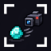
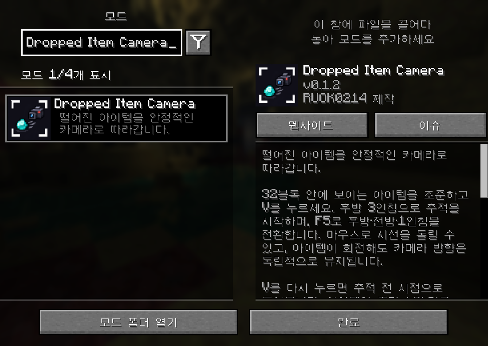
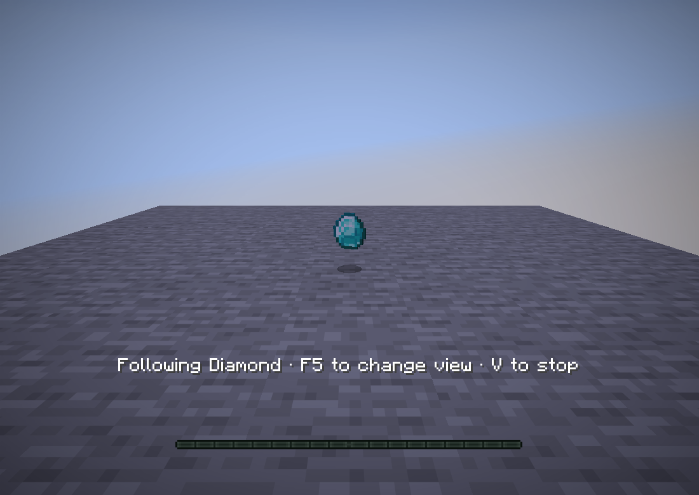

# Dropped Item Camera · 아이템 추적 카메라



떨어진 아이템의 움직임을 따라가는 Minecraft 클라이언트 모드입니다.
카메라 방향은 아이템의 회전과 독립적으로 유지되며, F5로 세 가지 시점을 사용할 수 있습니다.

[최신 버전 다운로드](https://github.com/RUOK0214/dropped_item_camera/releases/latest) · [변경 내역](RELEASE_NOTES.md) · [문제 제보](https://github.com/RUOK0214/dropped_item_camera/issues)



## 설치

| 항목 | 지원 버전 |
| --- | --- |
| Minecraft Java Edition | 26.2 |
| Java | 25 이상 |
| Fabric Loader | 0.19.5 이상 |
| Fabric API | 0.160.0+26.2 이상 |
| Mod Menu | 선택 사항, 20.0.2에서 표시 확인 |

릴리스의 **dropped-item-camera-0.1.2.jar**와 Fabric API를 게임의 `mods` 폴더에 넣습니다.
업데이트할 때는 이전 Dropped Item Camera JAR를 제거하고 교체하세요.
클라이언트에 설치하며, 멀티플레이에서도 클라이언트에 불러와진 아이템을 추적합니다.
설치용 JAR, 안내 문서를 포함한 ZIP, 개발용 소스 JAR를 릴리스에서 제공합니다.

## 사용법

1. 32블록 안에 보이는 떨어진 아이템을 조준합니다.
2. **V**를 누르면 아이템 뒤에서 추적을 시작합니다.
3. **F5**를 누를 때마다 후방 3인칭 → 전방 3인칭 → 1인칭으로 바뀝니다.
4. 마우스로 주위를 보고, **V**를 다시 눌러 추적 전 플레이어 시점으로 돌아옵니다.

설정 → 조작 → 키 지정 → **아이템 추적 카메라**에서 추적 단축키를 바꿀 수 있습니다.
시점 전환은 게임에 지정한 시점 변경 키를 사용합니다.



아이템을 줍거나 아이템이 소멸하는 등 추적 대상 엔티티가 사라지면 자동으로 복귀합니다.
다른 아이템 더미에 합쳐져 대상 엔티티가 사라질 때도 복귀합니다.
추적 범위는 클라이언트가 불러온 엔티티에 한정됩니다.
카메라 이동에는 게임의 위치 보간과 3인칭 벽 충돌 처리를 사용합니다.

## Mod Menu

전용 아이콘, 제작자, MIT 라이선스, 한국어·영어 요약과 사용법을 표시합니다.
소스 코드, 문제 제보, 릴리스 링크를 제공합니다.
설명 언어는 게임 언어와 Mod Menu의 설명 번역 설정을 따릅니다.
단축키는 게임의 키 지정 화면에서 변경합니다.

## English

Follow a visible dropped item within 32 blocks by aiming at it and pressing **V**.
Following begins in rear third person. **F5** cycles rear, front and first-person views.
Look around with the mouse. Camera angles remain independent of the item's rotation.
Press **V** again to return to your previous perspective.
Following also ends when the target entity disappears, including pickup, despawn or merging.

Install the release JAR with Fabric API on the client using Minecraft 26.2, Fabric Loader 0.19.5+ and Java 25+.
Tracking is limited to entities loaded by the client.
Rebind the follow key under Options → Controls → Key Binds → Dropped Item Camera.
Mod Menu optionally displays the icon, localized description, license and project links.

## 개발 및 검증

```powershell
.\gradlew.bat build
.\gradlew.bat runClientGameTest
```

Linux에서는 `./gradlew build`, 그래픽 화면 없는 환경에서는 `xvfb-run -a ./gradlew runClientGameTest`를 사용합니다.
게임 테스트에서 아이템 추적, F5 전환, 시점 복귀와 Mod Menu의 두 언어 설명·아이콘을 확인합니다.
GitHub Actions는 빌드와 게임 테스트를 통과한 main 커밋의 새 버전을 릴리스합니다.
릴리스에는 설치용 JAR, 소스 JAR, ZIP 및 SHA-256 체크섬이 포함됩니다.

## 라이선스

Copyright (c) 2026 RUOK0214. [MIT License](LICENSE).
아이콘도 같은 라이선스로 제공합니다. 0.1.2부터 사용자가 선택한 64×64 PNG(3,649바이트)를 사용합니다.
원본 디자인은 내장 ImageGen으로 제작했으며 [원본 생성 프롬프트](docs/icon-prompt.txt)를 보관합니다.
